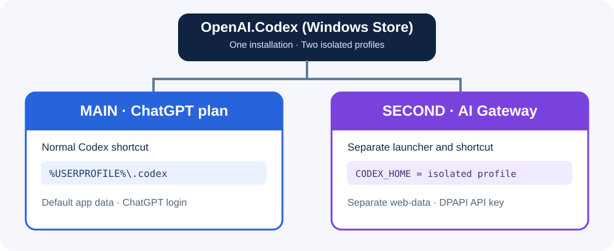

# Codex Dual Profile Manager for Windows

[ไทย](README.md) · [English](README.en.md)

> **Unofficial community project.** Not affiliated with OpenAI, Microsoft, or AskMe. The dual-instance Windows Store/MSIX launch workaround is version-sensitive and not a supported Codex feature.

PowerShell helpers for Windows 11 that support two workflows:

- **A — Replace the main Codex provider:** back up and edit `%USERPROFILE%\.codex\config.toml` to use a custom Responses API gateway. Restore the original config from the generated backup when finished.
- **B — Run two separate Codex Desktop windows:** keep your main Codex profile signed into ChatGPT, and launch an isolated second profile with a gateway provider and its own Chromium user-data directory.



## Prerequisites

Windows 11, Microsoft Store `OpenAI.Codex`, Windows PowerShell 5.1, an API key, and a gateway implementing the OpenAI **Responses API**. A Chat Completions-only endpoint is not sufficient. You must have access to the model you choose.

## Quick start: dual profile

Download the source ZIP or a tagged Release, extract it, open PowerShell in the repository directory, then run:

```powershell
powershell.exe -NoProfile -ExecutionPolicy Bypass -File .\scripts\Install-GatewayProfile.ps1 -ProfileName AskMe -Model "gpt-6.1-sol" -BaseUrl "https://myai.askme.co.th/api/v1/proxy/openai/v1"
```

Enter the gateway key in the hidden prompt. The script stores a DPAPI-encrypted credential under `%LOCALAPPDATA%\Codex-Gateway-Profiles\AskMe` and creates the **Codex - AskMe Gateway** desktop shortcut. It never edits the main Codex config. A basic API request may consume quota; add `-SkipApiTest` to opt out.

Keep the main Codex window open and launch the new shortcut. Verify the model, run a real tool call, and inspect gateway request logs to confirm routing.

## Quick start: replace main provider

**Close the main Codex window first. This edits its config.**

```powershell
powershell.exe -NoProfile -ExecutionPolicy Bypass -File .\scripts\Set-MainProvider.ps1 -Action Enable -Model "gpt-6.1-sol" -BaseUrl "https://myai.askme.co.th/api/v1/proxy/openai/v1"
```

Keep the timestamped backup path printed by the script. To restore:

```powershell
powershell.exe -NoProfile -ExecutionPolicy Bypass -File .\scripts\Set-MainProvider.ps1 -Action Restore -BackupPath "C:\path\to\config.toml.backup-YYYYMMDD-HHMMSS"
```

Reopen Codex and sign in with ChatGPT if prompted.

## Compatibility and security

The setup uses command-backed custom provider authentication, not `env_key` at the same time. It stores the key encrypted for the current Windows account. Never commit a decrypted token, local profile folder, `.env`, or `auth.json`. Windows updates and Codex app changes may break the dual-window launcher. Static CI tests are provided, but the generalized installer has not yet been validated end-to-end on all Windows versions.

See the [Thai detailed guides](docs/02-dual-profile-th.md), [troubleshooting](docs/troubleshooting-th.md), [security](docs/security.md), and [architecture](docs/architecture.md).

**Status:** v0.1.0-beta · **License:** MIT
