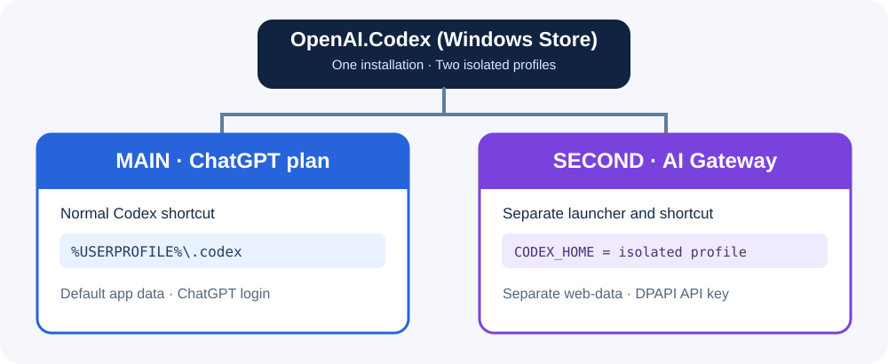

# Codex Dual Profile Manager for Windows

[ภาษาไทย](README.md) · [English](README.en.md)

> **Community project — not affiliated with or endorsed by OpenAI, Microsoft, or AskMe.** The dual-window launch technique uses an unofficial Windows Store/MSIX workaround. It may stop working after Windows or Codex updates.

เครื่องมือ PowerShell สำหรับใช้งาน **Codex Desktop บน Windows 11** ร่วมกับ **AI Gateway ที่รองรับ Responses API** โดยมี 2 โหมด:

| โหมด | ผลลัพธ์ | กระทบ Codex ตัวเดิมหรือไม่ |
|---|---|---|
| **A. Replace Main** | เปลี่ยน Codex ตัวหลักไปใช้ Gateway | **ใช่** — สำรอง `config.toml` ก่อนแก้ และมีคำสั่ง Restore |
| **B. Dual Profile** | Codex หลักใช้ ChatGPT; อีกหน้าต่างใช้ Gateway | **ไม่** — สร้าง Config, ข้อมูลแอป และ Shortcut แยก |



## สิ่งที่ต้องมี

- Windows 11 และ **Codex Desktop ที่ติดตั้งจาก Microsoft Store** (`OpenAI.Codex`)
- Windows PowerShell 5.1
- API Key ของ Gateway ที่ใช้งานได้ และ Gateway รองรับ **`POST /responses`** (ไม่ใช่แค่ Chat Completions)
- โมเดลที่ Gateway เปิดสิทธิ์ให้ใช้ (ค่าเริ่มต้นสำหรับ AskMe คือ `gpt-6.1-sol` ซึ่งเคยทดสอบผ่านกับบัญชีหนึ่ง; **ไม่รับประกันสิทธิ์ของทุกบัญชี**)

**ก่อนรัน:** อ่านสคริปต์ที่ดาวน์โหลดก่อนทุกครั้ง ห้ามอัปโหลด API Key หรือโฟลเดอร์โปรไฟล์ส่วนตัวขึ้น GitHub

## ดาวน์โหลด

1. ไปที่หน้า [Releases](../../releases) และดาวน์โหลด `Codex-Dual-Profile-Windows.zip` เมื่อมีการเผยแพร่ Release หรือใช้ปุ่ม **Code → Download ZIP** บน GitHub
2. แตก ZIP แล้วเปิดโฟลเดอร์โปรเจกต์
3. ใน File Explorer กด `Ctrl + L` พิมพ์ `powershell` แล้ว Enter

> การใช้ `-ExecutionPolicy Bypass` ด้านล่างมีผลเฉพาะโปรเซส PowerShell ที่รันสคริปต์ ไม่ได้เปลี่ยน Policy ของเครื่องถาวร

## วิธี B — เปิด Codex สองหน้าต่าง (แนะนำ)

ให้ Codex ตัวหลักล็อกอิน ChatGPT ตามปกติ แล้วเปิด PowerShell **ในโฟลเดอร์โปรเจกต์** และรัน:

```powershell
powershell.exe -NoProfile -ExecutionPolicy Bypass -File .\scripts\Install-GatewayProfile.ps1 -ProfileName AskMe -Model "gpt-6.1-sol" -BaseUrl "https://myai.askme.co.th/api/v1/proxy/openai/v1"
```

สคริปต์จะถาม API Key แบบซ่อนข้อความ เก็บแบบ DPAPI ของผู้ใช้ Windows สร้างโฟลเดอร์แยกใน `%LOCALAPPDATA%\Codex-Gateway-Profiles\AskMe` และสร้าง Shortcut **Codex - AskMe Gateway** บน Desktop

เปิด Codex หลักก่อน แล้วเปิด Shortcut ที่สร้างใหม่ ทดลองใช้งานจริง และตรวจ Request Logs ใน Gateway เพื่อยืนยันว่าแยก Provider ถูกต้อง

[คู่มือฉบับละเอียดพร้อมภาพและวิธีตรวจสอบ](docs/02-dual-profile-th.md)

## วิธี A — เปลี่ยน Codex ตัวหลักให้ใช้ Gateway

**วิธีนี้แก้ Config ตัวหลัก**: ปิด Codex Desktop ก่อน แล้วรัน

```powershell
powershell.exe -NoProfile -ExecutionPolicy Bypass -File .\scripts\Set-MainProvider.ps1 -Action Enable -Model "gpt-6.1-sol" -BaseUrl "https://myai.askme.co.th/api/v1/proxy/openai/v1"
```

สคริปต์สำรอง `%USERPROFILE%\.codex\config.toml` เป็นไฟล์มี timestamp ก่อนแก้ไข จดชื่อไฟล์ Backup ที่แสดงบนหน้าจอไว้ เมื่อจะกลับไปใช้ ChatGPT ให้ปิด Codex แล้ว Restore:

```powershell
powershell.exe -NoProfile -ExecutionPolicy Bypass -File .\scripts\Set-MainProvider.ps1 -Action Restore -BackupPath "C:\path\to\config.toml.backup-YYYYMMDD-HHMMSS"
```

จากนั้นเปิด Codex และตรวจการเข้าสู่ระบบ ChatGPT อีกครั้ง

[คู่มือวิธี A แบบละเอียด](docs/01-replace-main-th.md)

## ตรวจสอบ API

หลังติดตั้งโปรไฟล์แยก ระบบจะทดสอบ Responses API หนึ่งคำขอ (อาจมีค่าใช้จ่าย/ใช้โควตา) หรือใช้ `-SkipApiTest` เพื่อข้ามการทดสอบตอนติดตั้ง จากนั้นทดสอบภายหลังด้วย:

```powershell
powershell.exe -NoProfile -ExecutionPolicy Bypass -File .\scripts\Test-GatewayAPI.ps1 -ProfileRoot "$env:LOCALAPPDATA\Codex-Gateway-Profiles\AskMe"
```

ผล `PASS` ยืนยันเฉพาะ **คำขอ Responses API พื้นฐาน** ยังต้องทดสอบ Streaming, Tool Calling และ Codex Desktop จริง

## เอกสารเพิ่มเติม

- [วิธี A — เปลี่ยนตัวหลัก](docs/01-replace-main-th.md)
- [วิธี B — สองโปรไฟล์](docs/02-dual-profile-th.md)
- [แก้ปัญหา HTTP 403, PowerShell, Shortcut](docs/troubleshooting-th.md)
- [ความปลอดภัยและข้อจำกัด](docs/security.md)
- [สถาปัตยกรรมและไฟล์ที่สร้าง](docs/architecture.md)
- [คู่มือเผยแพร่ขึ้น GitHub](docs/publishing-th.md)
- [ประวัติการเปลี่ยนแปลง](CHANGELOG.md) · [ร่วมพัฒนา](CONTRIBUTING.md)

## ความปลอดภัยและการทดสอบ

- ไม่บันทึก API Key เป็นข้อความธรรมดาใน `config.toml`; ใช้ Windows DPAPI ของผู้ใช้ปัจจุบัน
- ไม่รวมไฟล์ `*.dpapi`, `auth.json`, `.env` หรือ Config ส่วนตัวใน Repository
- ไม่ดาวน์โหลดโปรแกรมจาก URL ภายนอกโดยอัตโนมัติ และไม่เปลี่ยน Windows Execution Policy ถาวร
- มีการทดสอบแบบ Static ใน GitHub Actions; **ยังไม่มีการทดสอบ GUI/MSIX อัตโนมัติครบทุกเวอร์ชัน**
- หากต้องการ Gateway อื่น เปลี่ยน `-BaseUrl` และ `-Model` ตามผู้ให้บริการ โดยต้องรองรับ Responses API

## สถานะ

**v0.1.0-beta — Community preview.** สคริปต์ทั่วไปจัดทำจากวิธีที่เคยใช้งานได้บนเครื่อง Windows หนึ่งเครื่อง แต่ชุด Generic นี้ยังต้องทดสอบแบบ end-to-end เพิ่มก่อนถือว่าเสถียร

## License

MIT — ดู [LICENSE](LICENSE)