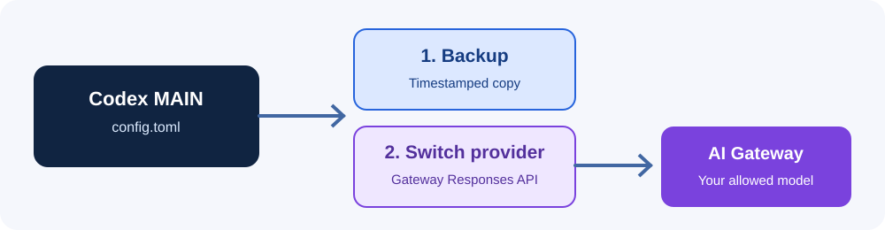

# วิธี A: ใช้ AI Gateway แทน Codex ตัวหลัก



> **วิธีนี้แก้ `%USERPROFILE%\.codex\config.toml` จริง** ควรปิด Codex Desktop และสำรองข้อมูลก่อน ห้ามใช้สคริปต์นี้หากต้องการให้ตัวหลักใช้ ChatGPT Plus ต่อไปโดยไม่เปลี่ยนค่า

## 1. ตรวจสอบและเตรียมตัว

1. ติดตั้ง Codex Desktop จาก Microsoft Store แล้วเปิดได้ตามปกติ
2. เตรียม API Key และชื่อโมเดลที่บัญชี Gateway มีสิทธิ์ใช้
3. ดาวน์โหลด Repository หรือ ZIP แล้วแตกไฟล์
4. เข้าโฟลเดอร์โปรเจกต์ใน File Explorer กด `Ctrl + L` พิมพ์ `powershell` แล้ว Enter
5. ปิด Codex Desktop ก่อนรันสคริปต์

## 2. ตั้งค่า Gateway

```powershell
powershell.exe -NoProfile -ExecutionPolicy Bypass -File .\scripts\Set-MainProvider.ps1 -Action Enable -Model "gpt-6.1-sol" -BaseUrl "https://myai.askme.co.th/api/v1/proxy/openai/v1"
```

สคริปต์จะให้กรอก API Key แบบซ่อนข้อความ (หากยังไม่เคยเก็บ Key สำหรับโหมดนี้) แล้วสำรอง Config เดิมเป็น `config.toml.backup-YYYYMMDD-HHMMSS` ก่อนเปลี่ยน Provider และ Model ใน Config หลัก

> ค่า `gpt-6.1-sol` เป็นตัวอย่างจาก AskMe ที่เคยทดสอบผ่าน ไม่ใช่การรับรองว่าทุกบัญชีใช้งานได้ ให้เปลี่ยน `-Model` ตามสิทธิ์ของคุณ

## 3. ทดสอบ

เปิด Codex ตัวหลักใหม่ สร้างแชททดสอบสั้น ๆ แล้วทดลองให้ Codex ใช้ Terminal หรือเครื่องมืออื่นด้วย ตรวจ Request Logs ของ Gateway เพื่อยืนยันว่าคำขอไปถึง Gateway จริง

## 4. กลับไปใช้ ChatGPT Plus

ปิด Codex แล้ว Restore จากไฟล์สำรองที่สคริปต์แสดงไว้:

```powershell
powershell.exe -NoProfile -ExecutionPolicy Bypass -File .\scripts\Set-MainProvider.ps1 -Action Restore -BackupPath "C:\path\to\config.toml.backup-YYYYMMDD-HHMMSS"
```

สคริปต์สำรอง Config ปัจจุบันอีกครั้งก่อน Restore จากนั้นเปิด Codex และเข้าสู่ระบบ ChatGPT หากจำเป็น การคืน Config ไม่ได้เปลี่ยนสถานะการล็อกอินโดยอัตโนมัติ

## หมายเหตุความปลอดภัย

- ห้ามวาง API Key ลงในไฟล์ TOML, README หรือ Screenshot
- การรันสคริปต์นี้เป็นการแก้ Config ตัวหลักโดยตั้งใจ ต่างจากวิธี B
- หาก Config มี Provider ชื่อ `gateway_main` อยู่แล้ว สคริปต์จะหยุดเพื่อป้องกันตาราง TOML ซ้ำ
- หากมีการอัปเดต Codex ให้ตรวจความเข้ากันได้อีกครั้ง
