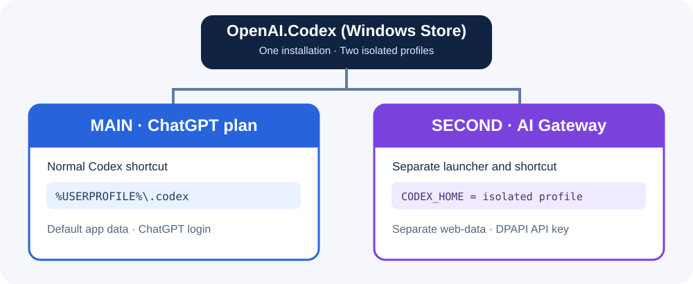
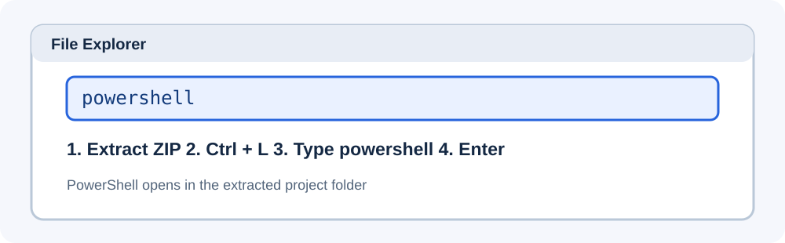
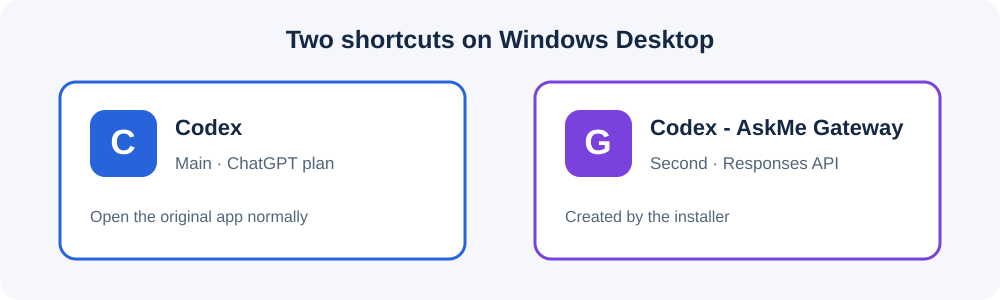

# วิธี B: เปิด Codex Desktop สองโปรไฟล์พร้อมกัน



> **วิธีนี้เป็น Windows/MSIX workaround ที่ไม่เป็นทางการ** ผลลัพธ์ขึ้นอยู่กับเวอร์ชันของ Codex และ Windows ต้องตรวจการแยกโปรไฟล์จริงทุกครั้งหลังอัปเดต

## 1. ติดตั้ง Codex หลัก

ติดตั้ง **Codex Desktop จาก Microsoft Store** (`OpenAI.Codex`) และเข้าสู่ระบบด้วยบัญชี ChatGPT ตามแพ็กเกจของคุณก่อน

## 2. ดาวน์โหลดไฟล์และเปิด PowerShell

1. ดาวน์โหลด Source ZIP จาก GitHub หรือ ZIP จากหน้า Releases เมื่อมี
2. แตกไฟล์ ZIP แล้วเปิดโฟลเดอร์โปรเจกต์
3. คลิกช่องที่อยู่ของ File Explorer หรือกด `Ctrl + L`
4. พิมพ์ `powershell` แล้ว Enter



*ภาพจำลอง: คลิกแถบที่อยู่ พิมพ์ `powershell` แล้ว Enter*

## 3. ติดตั้งโปรไฟล์ AskMe

คัดลอกคำสั่งนี้ทั้งบรรทัดไปวางใน PowerShell ที่เปิดจากโฟลเดอร์โปรเจกต์:

```powershell
powershell.exe -NoProfile -ExecutionPolicy Bypass -File .\scripts\Install-GatewayProfile.ps1 -ProfileName AskMe -Model "gpt-6.1-sol" -BaseUrl "https://myai.askme.co.th/api/v1/proxy/openai/v1"
```

เมื่อขึ้น `Gateway API key` ให้กรอก Key ของคุณ **ใน PowerShell เท่านั้น** ตัวอักษรจะไม่ปรากฏบนจอ จากนั้นสคริปต์จะ:

- ตรวจสอบ Codex Store/MSIX และ `Invoke-CommandInDesktopPackage`
- สร้าง `%LOCALAPPDATA%\Codex-Gateway-Profiles\AskMe\codex-home\config.toml`
- เก็บ API Key แบบ Windows DPAPI ในโปรไฟล์นั้น
- สร้าง Launcher และ Shortcut **Codex - AskMe Gateway** บน Desktop
- ทดสอบ Responses API หนึ่งคำขอ (อาจมีค่าใช้จ่าย); ใช้ `-SkipApiTest` ถ้าต้องการข้าม

## 4. เปิดสองหน้าต่าง



*ภาพจำลอง Shortcut ที่ใช้เปิด Codex สองโปรไฟล์*

1. เปิด **Codex** จากไอคอนปกติ (ChatGPT)
2. ดับเบิลคลิก **Codex - AskMe Gateway** (Gateway)
3. เปิดโปรเจกต์ทดสอบ ส่งข้อความ และทดลองใช้ Terminal ในทั้งสองหน้าต่าง
4. ดู Request Logs ของ AskMe เพื่อยืนยันว่ามีคำขอจากหน้าต่างที่สองจริง

### โครงสร้างไฟล์หลังติดตั้ง

```text
%USERPROFILE%\.codex\                      # MAIN: ไม่แก้ไข
%LOCALAPPDATA%\Codex-Gateway-Profiles\AskMe\
  api-key.dpapi                             # ความลับส่วนตัว ห้ามอัปโหลด
  codex-home\config.toml                   # Config แยก
  web-data\                                # ข้อมูลแอปแยก
  Start-GatewayProfile.ps1
  Get-ProfileToken.ps1
  Test-GatewayAPI.ps1
```

## 5. เปลี่ยนโมเดลหรือ Endpoint

หากต้องการเปลี่ยนค่าใน Config แยก ให้ปิดหน้าต่าง AskMe แล้วรัน Installer ใหม่พร้อม `-ReplaceConfig` (สคริปต์สำรอง Config เดิมก่อนเขียนใหม่):

```powershell
powershell.exe -NoProfile -ExecutionPolicy Bypass -File .\scripts\Install-GatewayProfile.ps1 -ProfileName AskMe -Model "MODEL_THAT_YOU_CAN_USE" -BaseUrl "https://gateway.example.com/v1" -ReplaceConfig
```

หากต้องการเปลี่ยน Key ให้เพิ่ม `-UpdateKey` ขณะติดตั้งซ้ำ อย่าส่ง Key ผ่านอาร์กิวเมนต์คำสั่ง

## 6. ทดสอบ API ภายหลัง

```powershell
powershell.exe -NoProfile -ExecutionPolicy Bypass -File .\scripts\Test-GatewayAPI.ps1 -ProfileRoot "$env:LOCALAPPDATA\Codex-Gateway-Profiles\AskMe"
```

`PASS` หมายถึง Basic Responses API ผ่านเท่านั้น ยังไม่ยืนยัน Streaming, Tool Calling และความถูกต้องของเส้นทางการคิดเงิน

## 7. ยกเลิกโปรไฟล์ที่สอง

ปิดหน้าต่าง AskMe แล้วลบ Shortcut **Codex - AskMe Gateway** หากไม่ต้องการใช้อีก หากต้องการลบข้อมูลโปรไฟล์ ให้ตรวจโฟลเดอร์ `%LOCALAPPDATA%\Codex-Gateway-Profiles\AskMe` ก่อนลบเอง (รวมทั้งประวัติและ Key เข้ารหัส) **อย่าลบ `%USERPROFILE%\.codex` ของตัวหลัก**
