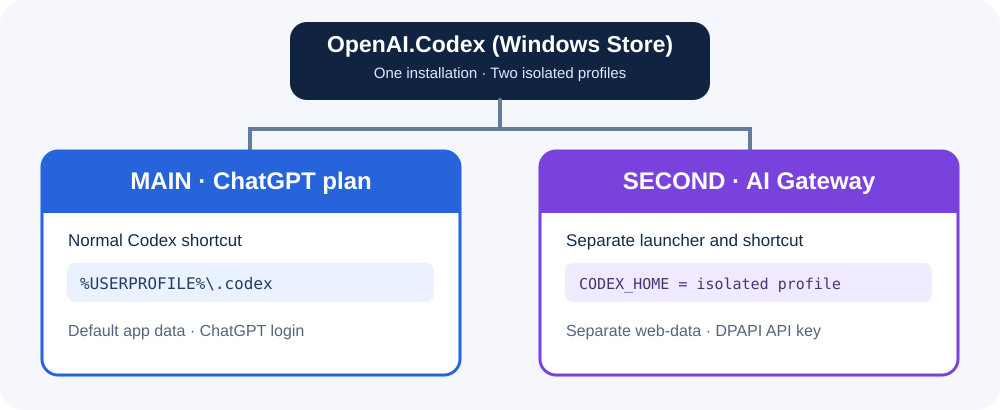

# Architecture



## Workflow A — replace main

`Set-MainProvider.ps1` backs up `%USERPROFILE%\.codex\config.toml`, then changes only the root `model`/`model_provider` selection and appends a custom provider with command-backed DPAPI authentication. Existing tables are preserved. Restore copies a chosen timestamped backup into place, with a safety copy of the current config.

## Workflow B — dual profile

`Install-GatewayProfile.ps1` creates `%LOCALAPPDATA%\Codex-Gateway-Profiles\<ProfileName>` with:

```text
api-key.dpapi               DPAPI-encrypted key (never commit)
codex-home/config.toml      Custom provider config
web-data/                   Isolated app web data
Get-ProfileToken.ps1        Command-backed token helper
Test-GatewayAPI.ps1         Basic Responses API smoke test
Start-GatewayProfile.ps1    MSIX launcher
launch-gateway.cmd          Generated at launch
```

`Start-GatewayProfile.ps1` invokes a CMD wrapper **inside the MSIX package context**. The wrapper sets `CODEX_HOME` for the child process and starts the Codex executable with `--user-data-dir` pointing at the isolated `web-data` directory. This technique is unofficial and version-sensitive.

## Authentication

The generated provider uses `[model_providers.gateway.auth]` to call `Get-ProfileToken.ps1`. The helper reads the DPAPI file and emits a bearer token to the calling Codex process. Do not combine this auth table with `env_key` or `requires_openai_auth`.

## Validation

The smoke test sends a single non-streaming `POST {base_url}/responses` request with the chosen model and a short input. It intentionally does not log the response body, token, or HTTP headers. An accepted request does **not** validate tool calling, streaming, or UI isolation.
